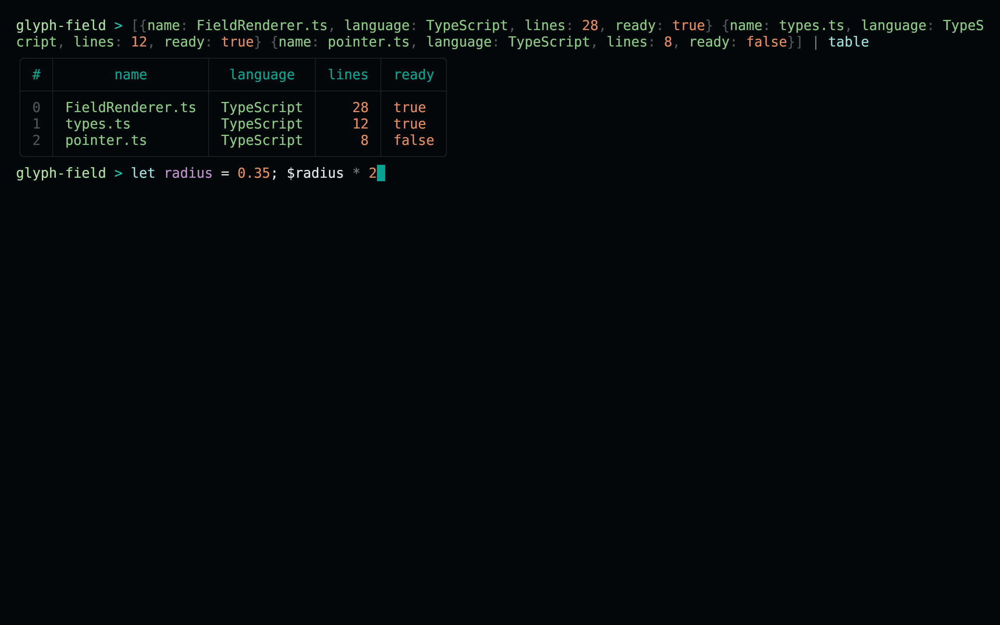
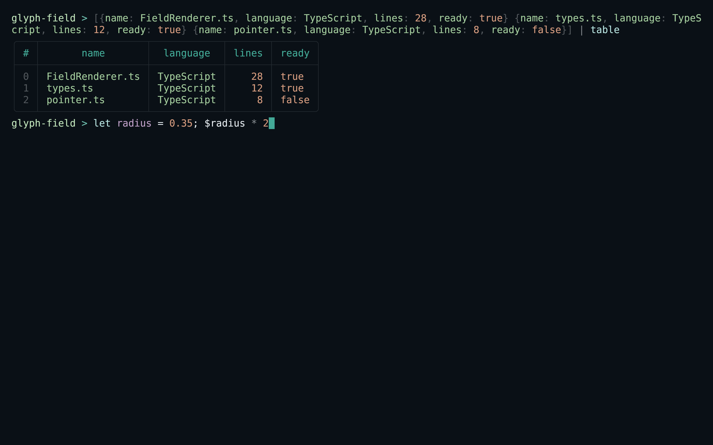
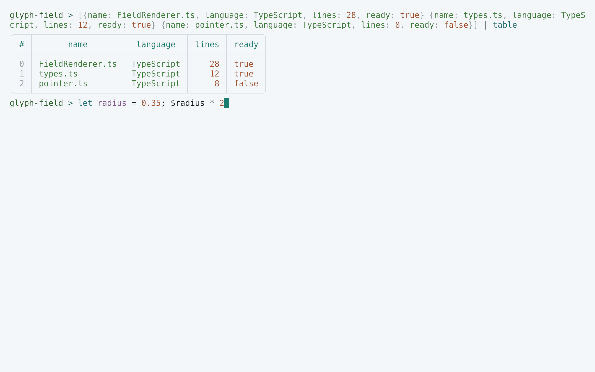
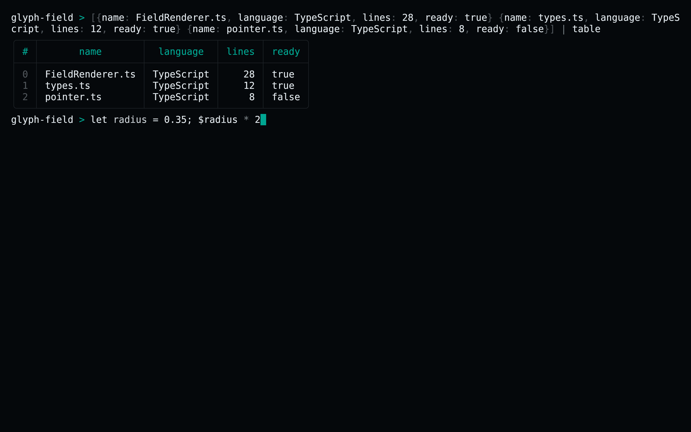

<!-- living-code-readme:1 -->
# 🐚 Living Code for Nushell

**Calm slate. Living color.** Living Code for Nushell: native modules for syntax shapes, structured values, tables, search matches and command-line hints.

[Installation](#installation) · [Flavors](#flavors) · [Configuration](#configuration) · [All ports](https://github.com/living-code-theme)

## Previews

<table data-lc-flavors>
<tr>
<td width="50%" valign="top">
<strong>Night</strong><br><sub>Dark · full palette</sub><br><br>
<a href="images/night.png"></a>
</td>
<td width="50%" valign="top">
<strong>Frost</strong><br><sub>Dark · softer chroma</sub><br><br>
<a href="images/frost.png"></a>
</td>
</tr>
<tr>
<td width="50%" valign="top">
<strong>Paper</strong><br><sub>Light · near-white slate</sub><br><br>
<a href="images/paper.png"></a>
</td>
<td width="50%" valign="top">
<strong>Signal</strong><br><sub>Dark · teal accent</sub><br><br>
<a href="images/signal.png"></a>
</td>
</tr>
</table>

Select any preview to view the image at full size.

## Installation

```sh
flavor=night # night, frost, paper, or signal
theme_dir="$(nu --no-config-file -c '$nu.default-config-dir')/themes"
curl -fsSL --create-dirs -o "$theme_dir/living-code-$flavor.nu" "https://raw.githubusercontent.com/living-code-theme/nushell/main/themes/living-code-$flavor.nu"
```

Run that download block in Bash/Zsh; `nu` reports the native config directory, including custom or platform-specific locations. Then add these lines **inside Nushell** to `config.nu` (adjust the module path to the directory reported above):

```nu
use ~/.config/nushell/themes/living-code-night.nu
$env.config.color_config = (living-code-night)
```

Restart Nu or evaluate the same two lines in the current session. Existing config and environment settings are not overwritten.

## Flavors

Expand a flavor for its full-size preview and activation instructions.

<details data-lc-flavor="night">
<summary><strong>Night</strong> · Dark · full palette</summary>

<p><a href="images/night.png"></a></p>

```nu
use ~/.config/nushell/themes/living-code-night.nu
$env.config.color_config = (living-code-night)
```

</details>

<details data-lc-flavor="frost">
<summary><strong>Frost</strong> · Dark · softer chroma</summary>

<p><a href="images/frost.png"></a></p>

```nu
use ~/.config/nushell/themes/living-code-frost.nu
$env.config.color_config = (living-code-frost)
```

</details>

<details data-lc-flavor="paper">
<summary><strong>Paper</strong> · Light · near-white slate</summary>

<p><a href="images/paper.png"></a></p>

```nu
use ~/.config/nushell/themes/living-code-paper.nu
$env.config.color_config = (living-code-paper)
```

</details>

<details data-lc-flavor="signal">
<summary><strong>Signal</strong> · Dark · teal accent</summary>

<p><a href="images/signal.png"></a></p>

```nu
use ~/.config/nushell/themes/living-code-signal.nu
$env.config.color_config = (living-code-signal)
```

</details>

## Configuration

Each file exports `main`, returning a color record without mutating `$env`. Set `color_config` explicitly as shown, or merge the returned record into your existing color configuration. Syntax shapes include keyword, literal, constant, function, type, string, variable, parameter and operator distinctions. Search results have explicit foreground/background pairs.

## Compatibility

Uses Nushell’s native module syntax and `color_config` API. The exported record follows the current shape-color contract; unknown supplemental record keys are inert. The theme does not configure prompts, LS_COLORS or the terminal emulator palette. Its `background`, `foreground` and `cursor` record entries are metadata used by theme tooling, not commands that recolor the host terminal. Native module loading can be tested with `pnpm test:native` when `nu` is installed.

Previews are captured programmatically from the actual application in an isolated profile. See [`capture/app.py`](capture/app.py) for the app-owned recipe and [`images/capture.json`](images/capture.json) for runtime, palette and image provenance. No mock interface is drawn.

## Contributing

Found a problem? [Open an issue](https://github.com/living-code-theme/nushell/issues/new/choose) with the app version, the flavor and a screenshot. Want Living Code somewhere else? [Request a port](https://github.com/living-code-theme/core/issues/new?template=port-request.yml).

Pull requests are welcome. Keep this README, `port.json` and `images/` in sync, and use real screenshots of the app, never mockups.

🦎 **One chameleon, many habitats.** Part of [Living Code](https://github.com/living-code-theme).

## License

[MIT](LICENSE) © Elliot Luque
